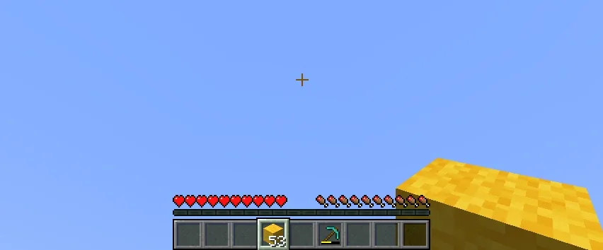

# PocketPalette

Switch between related items without opening your inventory.

Hold the Palette key (default: <kbd>R</kbd>) and scroll to swap your selected hotbar item with another item from the same group. Only items you already have in your inventory are available.

PocketPalette is a client-side mod for Survival and Creative. No server installation is needed.

Ready-to-use item groups are included. To customize a group, hover over an item in your inventory or a container and press the Palette key to open the editor. Your changes are saved automatically when you close it.

You can also edit `config/PocketPalette-ItemGroups.json` directly and run `/pocketpalette reload` to apply your changes.

This mod is a Survival-focused spin-off of the Palette feature from [LotTweaks](https://github.com/aruma256/LotTweaks).

If both mods use the same Palette key, LotTweaks handles that key in Creative mode, and PocketPalette continues to work in Survival. To use PocketPalette in Creative alongside LotTweaks, assign it a different Palette key.

Licensed under the [GNU General Public License v3.0](LICENSE).
