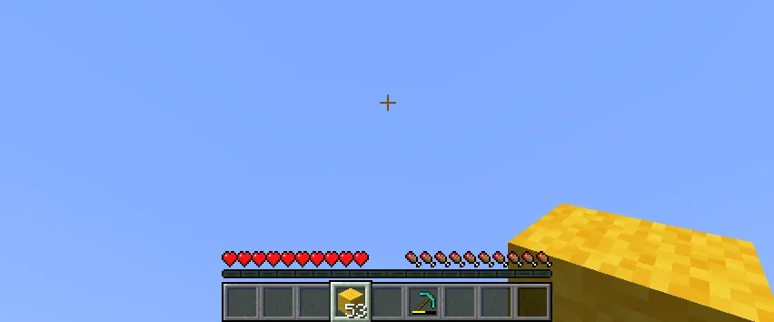

# PocketPalette

**[Download on CurseForge](https://www.curseforge.com/minecraft/mc-mods/pocketpalette)**

Switch between related items without opening your inventory.

Hold the Palette key (default: <kbd>R</kbd>) and scroll to swap your selected hotbar item with another item from the same cycle. A cycle is a list of related items, such as your tools or the colors of wool. Only items you already have in your inventory are available.

PocketPalette is a client-side mod for Survival and Creative. No server installation is needed.

It is available for Fabric and NeoForge. The Fabric version requires Fabric API.

Ready-to-use cycles are included. To customize one, hover over an item in your inventory or a container and press the Palette key to open the editor. Your changes are saved automatically when you close it.

Each item can have two cycles: one in Group 1 and one in Group 2. All included cycles are in Group 1, and Group 2 starts empty for your own. To use Group 2, double-tap the Palette key: tap it once, then quickly press it again and hold it while you scroll. In the editor, the Group button switches between the two.

You can also edit `config/PocketPalette-ItemGroups.json` directly and run `/pocketpalette reload` to apply your changes.

This mod is a Survival-focused spin-off of the Palette feature from [LotTweaks](https://github.com/aruma256/LotTweaks).

If both mods use the same Palette key, LotTweaks handles that key in Creative mode, and PocketPalette continues to work in Survival. To use PocketPalette in Creative alongside LotTweaks, assign it a different Palette key.

Licensed under the [GNU General Public License v3.0](LICENSE).
