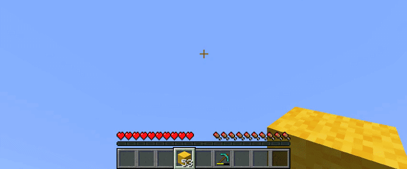

# PocketPalette

Turn one hotbar slot into a palette of related items for building, farming, or exploring. Hold the Palette key (default: <kbd>R</kbd>) and scroll to swap the selected item with another item from its group. Only items you carry appear in the palette. PocketPalette works in Survival and Creative.

[Watch the demo as a 60 fps MP4](docs/media/palette-demo.mp4).

Ready-to-use item groups are included. To customize a group, hover over an item in an inventory or container and press the Palette key. You can also edit `config/PocketPalette-ItemGroups.json` and run `/pocketpalette reload` to apply changes.

**Requirements:** Minecraft 1.21.8, Fabric Loader, Fabric API, and Java 21. Install the mod on your client; no server installation is needed.

This mod is a Survival-focused spin-off of the Palette feature from [LotTweaks](https://github.com/aruma256/LotTweaks).

Licensed under the [GNU General Public License v3.0](LICENSE).
