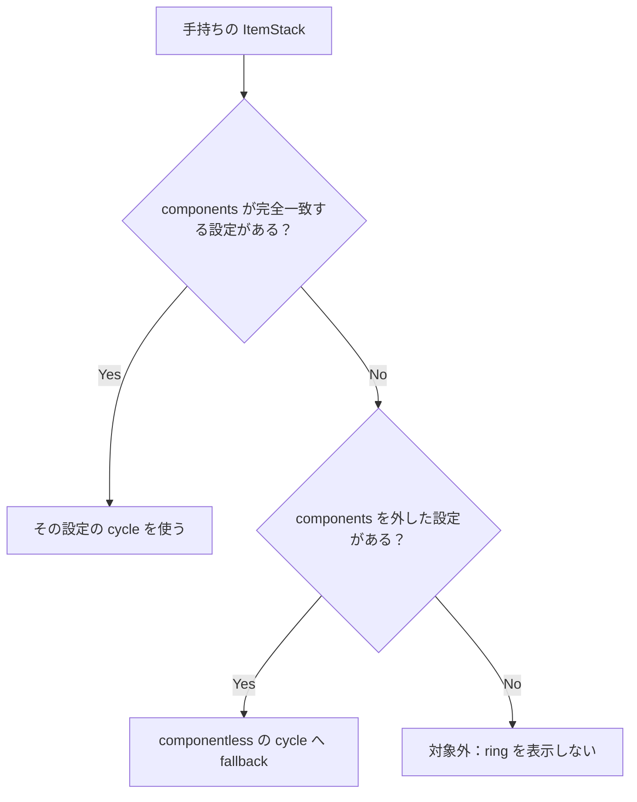

# Palette component matching

パレットの cycle は、手持ちアイテムを次の順で解決する。

- 手持ちが componentless の場合、最初の完全一致チェックがそのまま base item の検索になる。
- 手持ちに components がある場合、完全一致を優先し、なければ componentless 設定へ fallback する。

cycle 解決後、各設定項目からインベントリ内の実スタックを探す。

| 設定項目 | ring の候補 |
| --- | --- |
| componentless | 同じ base item の全スタック（耐久値・エンチャントなどは不問） |
| components 付き | item と components が完全一致するスタックだけ |

重要なのは、候補の照合条件が**手持ちの実スタックではなく、解決された設定項目**で決まること。たとえば componentless の `diamond_pickaxe` 設定なら、新品・損傷品・エンチャント品のどれを持っていても同じ cycle に入り、所持している全バリエーションが ring に並ぶ。
